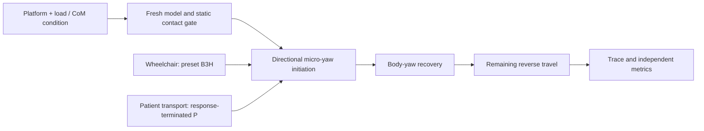
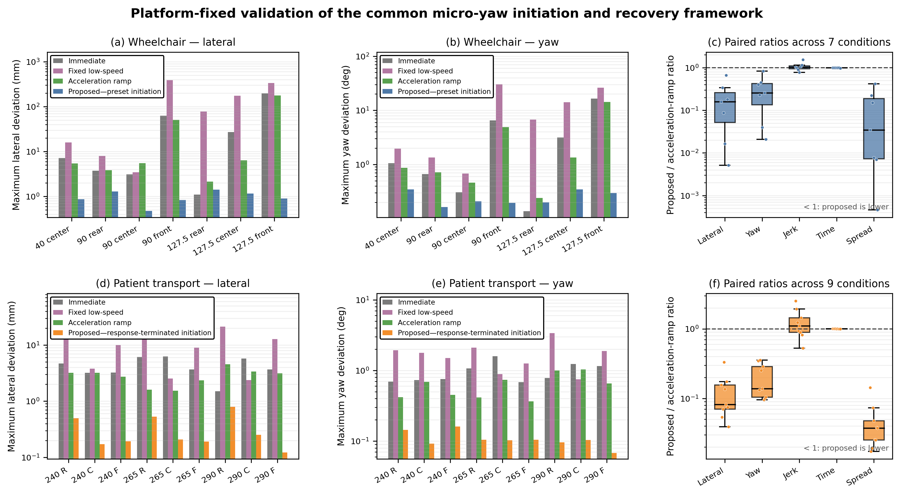

# Micro-Yaw Initial-Motion Control


캐스터 초기 오정렬과 하중·무게중심 변화에 따른 이동보조 플랫폼의 **방향 전환 출발 오차를 줄이는 미세 yaw 초기 구동·복원 제어** ROS 2–Isaac Sim 워크스페이스이다. 미세 yaw 구동으로 캐스터 전환을 유도한 뒤 차체 yaw를 복원한다. CICS 연구의 두 플랫폼 실험에 사용한 제어 코드, 고정 조건 선택기와 원본 결과 재계산 도구를 포함한다.

휠체어에는 **사전 설정형 초기 구동(B3H)**, 환자이승로봇에는 **최소 응답 종료형 초기 구동(P)**을 플랫폼 내 모든 조건에 고정한다. 조건마다 두 변형 중 좋은 결과만 고르는 방식이 아니다.

> 검증 범위는 시뮬레이션이다. 실제 환자를 태운 주행, 임상적 승차감 또는 의료기기 안전성을 검증한 결과가 아니다. 기본 실행은 설정 확인만 하며, 새 물리 주행에는 `stage:=run allow_motion:=true`를 명시해야 한다.

## 핵심 기능

- 캐스터 방향 전환 시 미세 yaw 초기 구동과 차체 yaw 복원
- 사전 설정형 / 응답 종료형 구현과 B0·B1·B2 비교
- 휠체어 7개, 환자이승 9개의 고정 하중·CoM 조건 선택
- 새 정적 접촉 검사 후 원본 3회 반복 루틴 실행
- ROS Python과 Isaac SDK Python을 분리한 표준 `ros2 run` / `ros2 launch` 진입점
- 원본 240회 trace에서 횡편차·yaw·jerk·시간·반복 궤적 분산 재계산
- 원본 제어·안전·평가 함수의 AST 및 대응 소스 SHA-256 보존 검사

## 1. 시스템 개요



ROS 패키지는 선택·프로세스 실행을 담당하고, 실제 제어·물리 stepping은 별도 Isaac SDK 프로세스의 보존된 구현이 수행한다. Script Editor에 실험별 코드를 복사할 필요가 없다. 이 저장소의 `P`는 출발 제어기이며, IJCAS 저장소의 경로계획 `P`와 다르다. Nav2 경로계획이나 병원 H1–H6 연속 이송이 이 연구의 본 비교는 아니다.

## 2. 검증 환경

| 항목 | 구성 |
|---|---|
| OS / ROS | Ubuntu 22.04 / ROS 2 Humble |
| Simulator | NVIDIA Isaac Sim 5.0 |
| Python | ROS: 시스템 3.10 / Isaac SDK: 별도 3.11 |
| Wheelchair | 연구실 구동 휠체어 모델, 7개 하중·CoM 조건 |
| Patient transport | 전·후방 조향 구동륜과 수동 캐스터 모델, 9개 질량·CoM 조건 |
| Repeats | 플랫폼·조건·방법당 3회 |
| Control and metrics | 플랫폼별 원본 scheduler와 분석 함수 사용 |

## 3. 보관된 실험 결과

| 항목 | Wheelchair | Patient transport |
|---|---:|---:|
| 조건 수 | 7 | 9 |
| 비교 방법 수 | 5 | 5 |
| 전체 기록 수 | 105 | 135 |
| 고정 제안 구현 | B3H: preset | P: response-terminated |
| 제안 구현 목표 도달 / 캐스터 전환 완료 | 21/21 / 21/21 | 27/27 / 27/27 |
| B2 대비 최대 횡편차의 조건별 감소율 중앙값 | 84.19% | 91.81% |
| B2 대비 최대 yaw 편차의 조건별 감소율 중앙값 | 74.35% | 86.14% |
| B2 대비 반복 궤적 분산의 조건별 감소율 중앙값 | 96.53% | 96.25% |

감소율은 각 조건의 원본 집계값에서 `100 × (B2 − proposed) / B2`를 계산한 뒤 조건 간 중앙값을 취한다. 전체 원시 표본을 합친 감소율이나 두 중앙값의 비율이 아니다. 제안 구현의 jerk·시간이 모든 조건에서 더 좋지는 않으며, 결정론적 반복의 한계도 있다. [평가 정의와 조건별 데이터](src/cics_experiments/docs/EXPERIMENTS.md)를 함께 확인한다.



위 그림과 [요약 CSV](src/cics_experiments/docs/data/platform_proposed_summary.csv)는 기존 최종 실험 산출물이다. raw trace와 새 실행 결과는 저장소에 포함하지 않는다.

## 4. 저장소 구조

```text
CICS_ws/
├── README.md
├── src/
│   ├── cics_experiments/
│   │   ├── cics_experiments/    # ROS CLI, SDK process, selector, reproduction
│   │   ├── runtime/             # 14 retained SDK implementation dependencies
│   │   ├── analysis/            # 7 original analysis dependencies
│   │   ├── assets/              # platform USD entry points
│   │   ├── config/              # source correspondence and hashes
│   │   ├── launch/
│   │   ├── docs/                # architecture, setup, results, troubleshooting
│   │   └── test/
│   ├── patient_transport_description/
│   └── wheelchair_description/
├── build/                       # generated by colcon
├── install/                     # standard install/setup.bash
├── log/                         # generated build / experiment / analysis output
└── archive/                     # local original evidence; excluded from Git
```

공개 대상은 `README.md`, `.gitignore`, `src/`이다. 원본 로그, 논문·발표 자료, 이전 개발 코드, 빌드 생성물과 이전 Git 데이터베이스는 공개하지 않는다. 원본은 로컬 `archive/`에 보존한다.

## 5. 설치와 실행

```bash
git clone https://github.com/jk2001-king/micro-yaw-initial-motion-control.git ~/CICS_ws
cd ~/CICS_ws
source /opt/ros/humble/setup.bash
rosdep install --from-paths src --ignore-src -r -y
colcon build --base-paths src --symlink-install
source install/setup.bash

# 코드만으로 사용 가능. SDK나 주행을 시작하지 않는다.
ros2 run cics_experiments experiment --list
ros2 launch cics_experiments experiment.launch.py \
  platform:=patient_transport condition:=265center method:=proposed stage:=check
```

Isaac SDK는 별도로 설치한다. 새 터미널은 `cd ~/CICS_ws` 후 `source install/setup.bash`를 사용한다. 별도 `setup_env.sh`는 없다.

```bash
# USD 장면 준비만 수행. Play / 물리 주행 없음.
ros2 launch cics_experiments experiment.launch.py \
  platform:=wheelchair condition:=90p0_center method:=proposed \
  stage:=prepare headless:=true sdk_python:=/path/to/isaac_env/bin/python

# 새 정적 검사 후 선택한 조건·방법의 원본 3회 루틴을 실행.
ros2 launch cics_experiments experiment.launch.py \
  platform:=patient_transport condition:=265center method:=proposed \
  stage:=run allow_motion:=true headless:=true \
  sdk_python:=/path/to/isaac_env/bin/python
```

새 출력은 `log/cics/experiments/<timestamp>/`에 저장한다. 원본 논문 결과를 덮어쓰지 않으며, 전체 실험 행렬이나 실패 조건을 자동 재시도하지 않는다.

| 인자 | 선택값 / 의미 |
|---|---|
| `platform` | `patient_transport`, `wheelchair` |
| `condition` | `experiment --list`의 플랫폼별 원본 조건 |
| `method` | `B0`, `B1`, `B2`, `P`, `B3H`, `proposed` |
| `stage` | `check`(기본), `prepare`, `run` |
| `allow_motion` | 기본 `false`; `run`은 `true` 필요 |
| `headless` | 기본 `true` |
| `sdk_python` | 별도 Isaac SDK Python 실행 파일 |
| `output` | 선택적 새 출력 폴더, 기존 폴더 재사용 금지 |

## 6. 결과 재계산과 검증 범위

```bash
# 아래 명령은 로컬 원본 자료가 필요하다. 새 주행은 시작하지 않는다.
ros2 run cics_experiments check
ros2 run cics_experiments reproduce_results
ros2 run cics_experiments reproduce_results --figures

python3 -m pytest src/cics_experiments/test -q
```

**코드와 원본 자료의 경계:** 코드 clone은 빌드·목록·선택 설정 확인을 지원한다. `check`의 전체 자료 점검, 원본 수치 재계산, 원본과의 AST 대조 시험은 별도로 보존된 raw 자료가 필요하다. `check --full`은 이관 전 Git까지 확인하는 로컬 보존 검사이다. 공개 요약 CSV는 raw trace의 대체물이 아니다. 복원 위치는 [SETUP](src/cics_experiments/docs/SETUP.md)에 정리했다.

정리 후 3개 패키지 빌드와 원본 자료가 있는 환경의 106개 검사를 통과했고, 240회 기록에서 재계산한 6개 표가 원본과 일치했다. 공개 이력 분리 검사 2개도 추가했다. 새 실행기로 환자이승 `265center/P`와 휠체어 `90p0_center/B3H`를 각각 3회 검증했고, 원본 trace의 공통 열·지표가 일치했다. 추가 진단 열 때문에 CSV 파일 전체가 byte-identical하다는 뜻은 아니다. 대표 조건 검증을 전체 240회의 새 실행으로 표현하지 않는다.

## 7. 문서

- [제어 구조와 구현 대응](src/cics_experiments/docs/ARCHITECTURE.md)
- [환경, 설치와 원본 자료 복원](src/cics_experiments/docs/SETUP.md)
- [조건, 평가 지표와 결과](src/cics_experiments/docs/EXPERIMENTS.md)
- [실행·경로·Python 문제 해결](src/cics_experiments/docs/TROUBLESHOOTING.md)
- [보존·정리·검증 이력](src/cics_experiments/docs/WORKFLOW.md)
- [외부 구성요소와 라이선스](src/cics_experiments/docs/THIRD_PARTY.md)

## 8. 관련 연구와 저장소 구분

| 저장소 | 연구 범위 |
|---|---|
| [patient-transport-initial-motion](https://github.com/jk2001-king/patient-transport-initial-motion) | 선행 초기 조향 구성·정렬 출발 제어 prototype |
| **이 저장소** | CICS: 방향 전환 시 미세 yaw 출발·복원 제어, 두 플랫폼 하중·CoM 비교 |
| [multi-steering-motion-planning](https://github.com/jk2001-king/multi-steering-motion-planning) | IJCAS: 응답 이력을 전파하는 병원 다중 조향 경로계획 |
| [transfer_robot_nav2](https://github.com/jk2001-king/transfer_robot_nav2) | 별도 실물 플랫폼의 센서·측위·Nav2 통합 |

같은 연구 흐름에서 확장했지만 제어 대상, 실험 조건, 지표와 결과 분모가 달라 별도 저장소로 유지한다. 선행 코드의 물리 치수나 조향 보정값을 이 실험에 그대로 적용하지 않는다.

## 9. 라이선스

NVIDIA Isaac Sim은 별도 설치·라이선스가 필요한 외부 소프트웨어이다. 각 패키지의 기존 `package.xml` 라이선스(`UNLICENSED`, `Proprietary`)를 유지하며 프로젝트 전체를 MIT/Apache로 재허가하지 않는다. 상세 내용은 [THIRD_PARTY](src/cics_experiments/docs/THIRD_PARTY.md)를 따른다.
